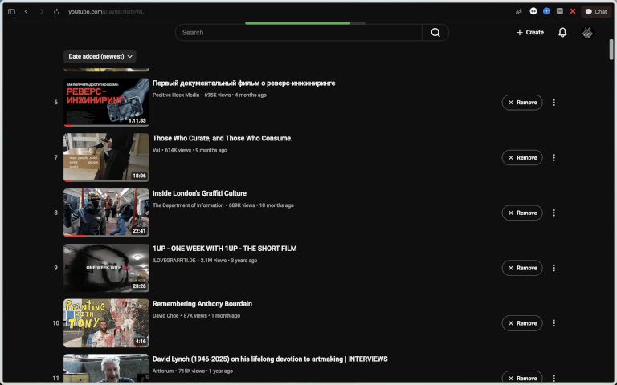

<sub>plz ignore green progress bar</sub>

[English](#english) · [Русский](#русский)

# English

## I Fixed YouTube

A distraction-free YouTube extension for Chromium browsers.

### Features

- Minimal home with **Subscriptions** and **Watch Later**.
- Optional recommendations twice a day, with regular videos only.
- No Shorts shelves, Playables, ads, Mixes, or membership promos.
- Four-column Subscriptions grid without **Most relevant**.
- Watched subscription videos are 80% transparent.
- One-click **Add to Watch Later** from Subscriptions and recommendation previews.
- Centered Watch Later list with one-click removal.
- Player and description without side or end-screen recommendations; comments open on demand for the current video.
- Native light and dark themes.

### Download and install

1. Open the [latest release](https://github.com/mxmlsn/ifixedyoutube/releases/latest).
2. Under **Assets**, download **`ifixedyoutube.zip`**. Do not download the automatically generated “Source code” archives.
3. Unzip `ifixedyoutube.zip` into a permanent folder.
4. Open `chrome://extensions` in Chrome, Edge, Brave, Arc, or another Chromium browser.
5. Enable **Developer mode**.
6. Click **Load unpacked** and select the entire unzipped `ifixedyoutube` folder.
7. Refresh any open YouTube tabs.

To update, download the newest `ifixedyoutube.zip`, replace the old files, then click **Reload** on the extension page.

---

# Русский

## I Fixed YouTube

YouTube без лишнего для Chrome и других Chromium-браузеров.

### Возможности

- Главная страница только с **Subscriptions** и **Watch Later**.
- Рекомендации два раза в сутки, только обычные видео.
- Без блоков Shorts, Playables, рекламы, Mix и предложений членства.
- Подписки в четыре колонки, без блока **Most relevant**.
- Просмотренные видео в подписках прозрачны на 80%.
- Добавление в **Watch Later** одним кликом из preview в подписках и рекомендациях.
- Отцентрированный список Watch Later с быстрым удалением.
- Плеер и описание без боковых и финальных рекомендаций; комментарии открываются по кнопке для текущего видео.
- Нативная светлая и тёмная темы.

### Скачивание и установка

1. Откройте [последний релиз](https://github.com/mxmlsn/ifixedyoutube/releases/latest).
2. В разделе **Assets** скачайте именно **`ifixedyoutube.zip`**. Автоматические архивы “Source code” скачивать не нужно.
3. Распакуйте `ifixedyoutube.zip` в постоянную папку.
4. Откройте `chrome://extensions` в Chrome, Edge, Brave, Arc или другом Chromium-браузере.
5. Включите **Режим разработчика** / **Developer mode**.
6. Нажмите **Загрузить распакованное расширение** / **Load unpacked** и выберите целиком распакованную папку `ifixedyoutube`.
7. Обновите открытые вкладки YouTube.

Для обновления скачайте новый `ifixedyoutube.zip`, замените старые файлы и нажмите **Перезагрузить** / **Reload** на странице расширений.


### Local checks / Локальная проверка

```sh
npm install
npx playwright install chromium
npm test
npm run test:browser
```

The browser check uses the local watch fixture at five viewport widths (390–1920 px). It checks native panel visibility, keyboard forwarding, text editing, ambient-container clipping and fullscreen video. The fixture simulates YouTube handlers, not Gemini responses from the live service.

For an optional live check in a fresh signed-out browser, run `npm run test:youtube`. This checks a public YouTube watch page: native keyboard feedback, fullscreen scrolling and chapter-panel resizing. It needs network access and does not test signed-in Gemini responses.

Локальная браузерная проверка проходит на пяти размерах окна (390–1920 px). Дополнительная проверка на настоящем YouTube без входа в аккаунт: `npm run test:youtube`. Проверяются штатные клавиши и индикация, fullscreen и главы; ответы Gemini с авторизацией не проверяются.
